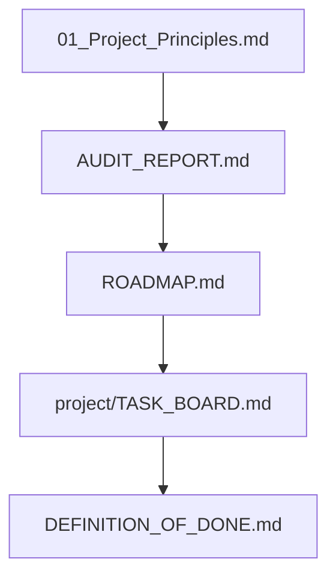

# 📖 Restaurant Landing System: Knowledge Base

Selamat datang di repositori dokumentasi **Restaurant Landing System**.
Dokumentasi ini disusun sebagai **Single Source of Truth** untuk memastikan setiap keputusan arsitektur, desain, dan rekayasa kode sejalan dengan prinsip inti proyek.

---

## 🧭 Navigasi Dokumentasi

| Dokumen | Deskripsi | Status |
|---|---|---|
| **[01_Project_Principles.md](./00_STRATEGY/01_Project_Principles.md)** | 14 Prinsip Fondasi Proyek (Konstitusi Sistem) | Active |
| **[AUDIT_REPORT.md](./AUDIT_REPORT.md)** | Laporan evaluasi menyeluruh kualitas kode, a11y, dan performa | Active |
| **[ROADMAP.md](./ROADMAP.md)** | Peta jalan rilis dan milestone rekayasa perangkat lunak | Active |
| **[TASK_BOARD.md](./project/TASK_BOARD.md)** | Papan kendali operasional task harian (Single Source of Truth) | Active |
| **[DEFINITION_OF_DONE.md](./DEFINITION_OF_DONE.md)** | Kriteria standar kualitas sebelum task dianggap selesai (DONE) | Active |

---

## 🎯 Aturan Kerja Saat Development
1. **Cek `TASK_BOARD.md` terlebih dahulu:** Selalu ambil task dari milestone yang aktif dan berstatus `READY`.
2. **Prinsip Konfigurasi:** Jangan melakukan hardcode nama restoran, teks menu, atau kontak di dalam komponen. Gunakan `src/config/restaurant.config.ts`.
3. **Patuhi Definition of Done:** Sebelum menandai task sebagai `DONE`, pastikan kode lolos `npm run build`, `npm run lint`, dan pengujian responsif.
4. **Pembaruan Berkelanjutan:** Setiap selesai mengerjakan task, perbarui persentase progress dan status pada `TASK_BOARD.md`.
