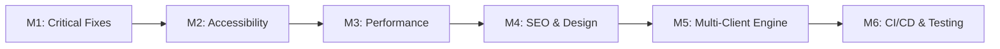

# 🗺️ Restaurant Landing System: Development Roadmap

Peta jalan rekayasa perangkat lunak untuk membawa **Restaurant Landing System** dari prototipe visual awal menjadi sistem landing page multi-klien berstandar produksi yang tangguh, cepat, dan mudah dikonfigurasi.

---

## 📌 Milestones Overview

---

## M1 - Critical Bug Fixes & Reservation Flow [✅ DONE]
*Target: Mengatasi celah kehilangan data pada alur reservasi dan validasi formulir.*
- Perbaiki validasi tanggal reservasi agar tidak menerima tanggal masa lalu.
- Sediakan mekanisme pengiriman data tamu yang andal (Direct WhatsApp dispatch / Webhook / Email / LocalStorage backup).
- Berikan state feedback yang informatif bagi calon tamu.
- **Kriteria Sukses:** Pengguna riil tidak kehilangan data pesanan mereka. (Lulus UAT & form validation).

## M2 - Accessibility & Semantic Structure [⏳ ACTIVE]
*Target: Memenuhi standar Accessibility by Default (WCAG 2.1 AA).*
- Koreksi struktur heading pada `SectionTitle` agar urutan outline logis.
- Perbaiki aksesibilitas keyboard pada kartu foto galeri dan tombol navigasi scroll.
- Pasang perangkap fokus (focus trap), ARIA dialog, dan scroll lock pada modal lightbox.
- **Kriteria Sukses:** Website dapat dinavigasi 100% menggunakan tombol Tab/Enter keyboard.

## M3 - Performance & Mobile UX Optimization [📋 READY]
*Target: Memenuhi standar Performance Always & Mobile First.*
- Ganti event listener scroll intensif dengan `IntersectionObserver` atau throttled observer.
- Pindahkan loading font ke `<head>` via preconnect untuk mempercepat FCP/LCP.
- Tambahkan lazy loading dan aspek rasio stabil pada seluruh gambar di bawah viewport fold.
- Rapikan drawer navigasi mobile dan scroll-lock saat drawer terbuka.
- **Kriteria Sukses:** Nilai Core Web Vitals tinggi dan interaksi scroll 60 FPS pada perangkat mobile.

## M4 - SEO & Design Consistency [📋 READY]
*Target: Memenuhi standar SEO First & Design First.*
- Pasang metadata Open Graph, Twitter Cards, dan meta description pada `index.html`.
- Standarisasi warna aksen `gold-500` dan background `zinc-950` secara konsisten di semua komponen.
- Atasi tautan dummy `#` pada footer.
- **Kriteria Sukses:** Tampilan preview kartu saat link dibagikan di WhatsApp/Twitter/Telegram muncul sempurna.

## M5 - Multi-Client Configuration Engine [📋 READY]
*Target: Mewujudkan prinsip One Codebase, Multi Client, & Configuration over Modification.*
- Buat skema konfigurasi terpusat berbasis TypeScript (`src/config/restaurant.config.ts`).
- Ekstrak seluruh teks, menu, harga, testimoni, jam buka, dan identitas restoran keluar dari komponen UI.
- Hapus artefak dan file konfigurasi legacy yang tidak terpakai (`tailwind.config.js`, `.eslintrc.cjs`).
- **Kriteria Sukses:** Rebranding restoran baru dapat dilakukan dalam waktu kurang dari 5 menit hanya dengan memodifikasi file konfigurasi.

## M6 - Quality Assurance & CI/CD Pipeline [📋 READY]
*Target: Memenuhi standar Long Term Maintainability.*
- Konfigurasi runner unit test (Vitest + React Testing Library).
- Tambahkan automated tests untuk validasi form, navigasi, dan integritas konfigurasi.
- Perbarui GitHub Actions workflow agar memverifikasi `npm run lint` dan `npm test` sebelum build & deploy.
- **Kriteria Sukses:** Zero regression release pada branch `main`.
